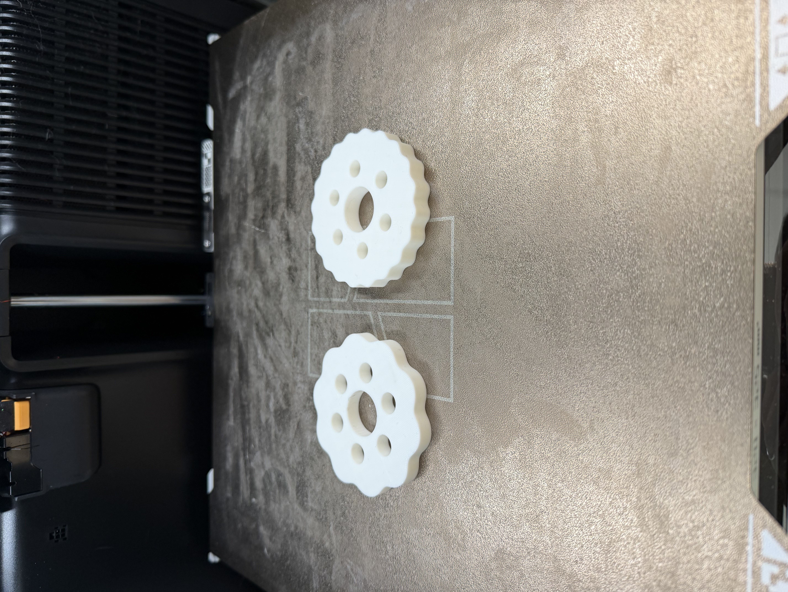

# Cycloidal Speed Reducer

A personal mechanical design project combining MATLAB geometry generation, SolidWorks modeling, and FDM fabrication. The aim is to build a compact cycloidal reducer and document the design decisions and measured performance.

**Status:** Gear components are FDM-printed. The housing, eccentric input shaft, output shaft, and bearing interfaces are being designed. The assembled reducer has not been bench-tested.

## My work

- Used MATLAB to generate cycloidal profiles for 10:1 and 20:1 reduction designs and export geometry for CAD.
- Modeled components in SolidWorks and FDM-printed the gear components.
- Am designing the remaining assembly components, considering eccentric motion, bearing interfaces, component fits, and assembly clearances.
- I used ChatGPT to help develop the MATLAB geometry generator. My work includes using the generated profiles in SolidWorks, modeling components, FDM-printing the gears, and designing the remaining assembly.

## Geometry generation

The included [MATLAB script](src/cycloidal_drive_generator_COMPLETE.m) produces nominal 2D disc geometry, a ring-pin layout, pin-coordinate tables, and a design summary. It does not complete the shaft, housing, bearing-fit, or strength design.

For the layout represented by this script, the fixed ring contains one more pin than the disc has lobes. Its default 20:1 reduction design therefore uses 21 ring pins and 20 disc lobes. A reduction ratio describes speed reduction; actual torque gain also depends on losses.

| Default script setting | Value |
| --- | --- |
| Target reduction ratio | 20:1 |
| Ring-pin pitch radius | 40 mm |
| Ring-pin diameter | 6 mm |
| Eccentricity factor | 0.50 |
| Calculated eccentricity | Approximately 0.952 mm |
| Center bore diameter | 22 mm |
| Number of output pins | 6 |
| Output-pin diameter | 6 mm |
| Output pitch radius | 20 mm |
| Output radial running clearance | 0.20 mm |

These are the included script's settings, not a verified as-built specification. Final dimensions and fits are still being developed.

## Run the script

1. Open MATLAB and set the current folder to `src`.
2. Open `cycloidal_drive_generator_COMPLETE.m` and review the user settings.
3. Run `cycloidal_drive_generator_COMPLETE`.
4. Inspect the plotted geometry before importing the DXF into CAD.

At the default ratio, the script writes a `cycloidal_20to1_output` folder containing:

- `cycloidal_disc_20to1.dxf`
- `ring_pin_pattern_20to1.dxf`
- `cycloidal_disc_20to1.txt`
- `output_hole_centers_20to1.csv`
- `ring_pin_centers_20to1.csv`
- `design_summary_20to1.txt`

Import the DXF with millimeter units and verify a known dimension. The disc perimeter is exported as connected LINE entities, so inspect the imported sketch for closure. Check interference and motion in the assembly before manufacturing remaining parts.

## Next design and testing steps

- Complete the eccentric shaft, housing, output assembly, and bearing interfaces.
- Record actual clearances and any changes required after assembly.
- Check motion manually and then test the assembled mechanism.
- Measure input and output rotation to verify the achieved reduction ratio.
- Measure output backlash and record the measurement method.
- Test performance under a known load and document the speed, load, and operating conditions.

## Evidence to add

The next update will include photos of the printed components, CAD screenshots, assembly drawings, and a short demonstration video. Measured results will be added after testing.

